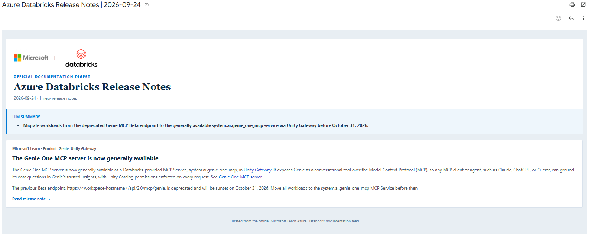

# Azure Databricks Release Notes Digest

[](https://github.com/MixKlim/databricks-digest/actions/workflows/databricks.yml)
[](https://raw.githubusercontent.com/mixklim/databricks-digest/main/reports/coverage/index.html)



Daily GitHub Actions workflow that reads the official [Azure Databricks release-notes RSS feed](https://learn.microsoft.com/en-us/azure/databricks/feed.xml) and emails new release notes. Microsoft documents this feed on the [Azure Databricks release-notes page](https://learn.microsoft.com/en-us/azure/databricks/release-notes/).

## GitHub workflow setup

Configure these secrets in the repository's `production` environment:

- `RECIPIENT_EMAIL`: the Gmail address used to send and receive the digest.
- `SMTP_APP_PASSWORD`: a Gmail app password.
- `GEMINI_API_KEY`: (optional) Gemini API key for the LLM digest summary.

The workflow runs daily at 07:00 UTC and can also be started manually from the Actions tab. GitHub scheduled workflows use UTC and can start later than scheduled during periods of high load.

The runner stores feed metadata and delivery status in `data/release_notes.sqlite3`, using Python's built-in SQLite support instead of Delta tables or PySpark. GitHub Actions restores and updates this small database through its cache so the state survives ephemeral runners. Feed `pubDate` is not used as a delivery gate, so future-dated items are eligible as soon as they appear. Repeated polls are idempotent by feed item ID, and failed email delivery leaves items pending for the next run. GitHub may evict caches, so the state cache is not a permanent database backup.

The feed client uses the fixed Microsoft Learn HTTPS endpoint, a bounded 30-second timeout, a descriptive user agent, and validates every returned link before capturing it.

## Local checks

Install the development dependencies with UV, then run:

```text
uv sync --dev
uv run pre-commit run --all-files
uv run pytest
```

### Local digest

This fetches release notes from the Microsoft Learn RSS feed and can send a publication-date window through email. No PySpark installation is required.

```powershell
Copy-Item .env.example .env
# Edit .env and replace the placeholder values.
uv sync --dev
uv run python scripts/local_digest.py --start-date 2026-09-01 --dry-run
uv run python scripts/local_digest.py --start-date 2026-09-01 --end-date 2026-09-05
```

`--start-date` selects the first local publication date in `YYYY-MM-DD` format. `--end-date` is optional; when provided, notes published through that date are included. Without it, only the start date is selected. The first command prints matching notes without sending mail. The second sends the matching notes without changing the scheduled digest's SQLite state. Unit tests cover feed parsing, date filtering, URL validation, SQLite state deduplication, and email composition.

### LLM digest summary

The `summarize_digest` function in `src/databricks_digest.py` uses Gemini to turn each release note into one short, professional, developer-focused bullet sentence. It emphasizes practical impact, compatibility or migration concerns, and concrete actions. The function is optional and does not change email delivery or SQLite state.

Set `GEMINI_API_KEY` in the GitHub `production` environment or in local `.env`. If Gemini is unavailable, the email is still sent without the LLM summary.

### Manual GitHub digest

Start the `Digest CI and daily delivery` workflow manually from the repository's Actions tab. The same SQLite cache is restored and updated as for the scheduled run.
